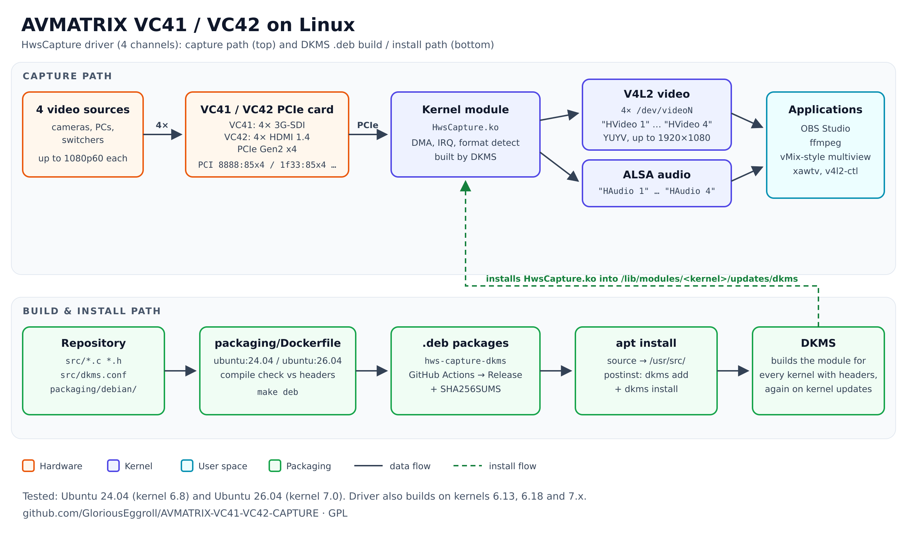

# AVMATRIX VC41 / VC42 Linux driver

[](https://github.com/GloriousEggroll/AVMATRIX-VC41-VC42-CAPTURE/releases/latest)
[](https://github.com/GloriousEggroll/AVMATRIX-VC41-VC42-CAPTURE/actions/workflows/build-deb.yml)
[](LICENSE)

Linux driver (`HwsCapture`) for the **AVMATRIX VC41** (4× 3G-SDI) and **VC42** (4× HDMI) PCIe capture cards,
up to 1080p60 per channel, with DKMS `.deb` packages for **Ubuntu 24.04 and 26.04**. Each input appears as its own
V4L2 video device and ALSA audio device, so it works with OBS Studio, vMix-style multi-camera setups, ffmpeg and VLC.

For the 4K60 VC12-4K card use
[AVMATRIX-VC12-4K-CAPTURE](https://github.com/GloriousEggroll/AVMATRIX-VC12-4K-CAPTURE).



## Install

Ubuntu 24.04 / 26.04, from the [latest release](https://github.com/GloriousEggroll/AVMATRIX-VC41-VC42-CAPTURE/releases/latest):

```sh
sudo apt install linux-headers-$(uname -r)
sudo apt install ./hws-capture-dkms_*ubuntu24.04_all.deb   # or *ubuntu26.04*
```

Other distributions (Debian, Fedora, RHEL, openSUSE, Arch, Manjaro): see
[build from source](doc/README.md#other-distributions-build-from-source).

## Use

```sh
v4l2-ctl --list-devices   # HVideo 1 … HVideo 4 → /dev/videoN
```

OBS Studio: one **Video Capture Device (V4L2)** source per input (`HVideo 1` … `HVideo 4`) and one
**Audio Input Capture (ALSA)** per input (`HAudio 1` … `HAudio 4`).

## Uninstall

```sh
sudo apt remove hws-capture-dkms     # or: sudo ./scripts/hws-uninstall.sh
```

## Documentation

[doc/README.md](doc/README.md): hardware details, install options, multi-channel ffmpeg examples, troubleshooting
(Secure Boot, headers), building the packages, CI and releases, where to buy, history.

Not affiliated with AVMATRIX. Licensed under the GPL, see [LICENSE](LICENSE).
