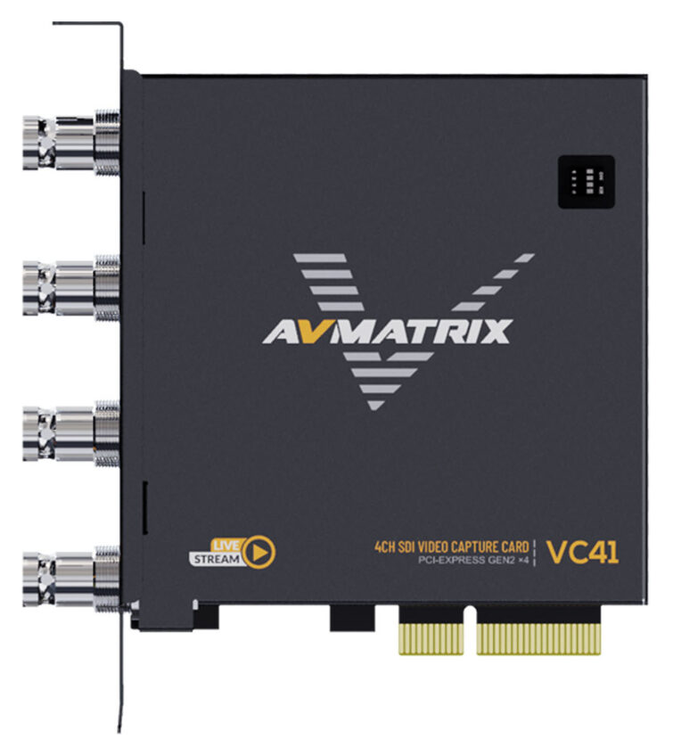
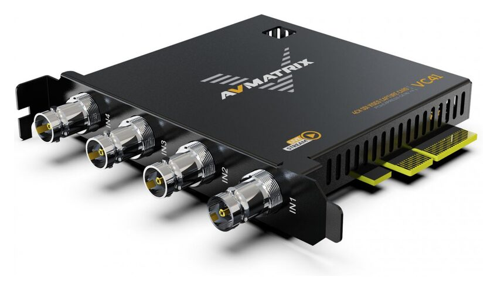
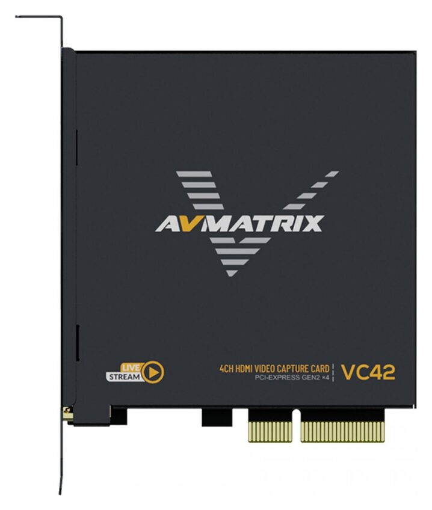
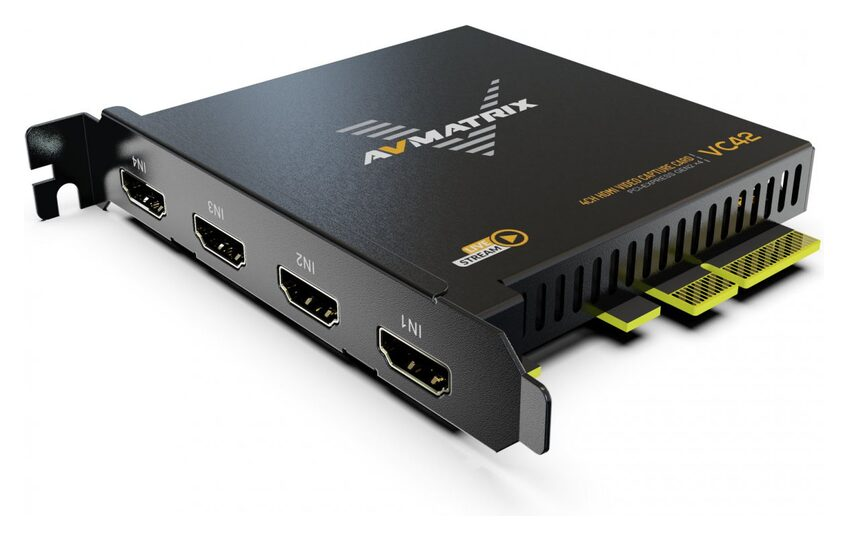

# AVMATRIX VC41 / VC42 on Linux: full guide

Back to the [project README](../README.md).

- [Hardware](#hardware)
- [How it works](#how-it-works)
- [Install](#install)
- [Check the installation](#check-the-installation)
- [Usage](#usage)
- [Uninstall](#uninstall)
- [Troubleshooting](#troubleshooting)
- [Building the packages](#building-the-packages)
- [CI and releases](#ci-and-releases)
- [Repository layout](#repository-layout)
- [Where to buy](#where-to-buy)
- [History](#history)

## Hardware

| VC41 (4× 3G-SDI) | | VC42 (4× HDMI) | |
|---|---|---|---|
|  |  |  |  |

<sub>Product photos © AVMATRIX, from avmatrix.com.</sub>

| | VC41 | VC42 |
|---|---|---|
| Inputs | 4× 3G-SDI | 4× HDMI 1.4 |
| Capture | 4 channels simultaneously, up to 1920×1080 60 fps each | same |
| Bus | PCIe Gen2 x4 | PCIe Gen2 x4 |
| Product page | [VC41](https://www.avmatrix.com/products/vc41-4ch-3g-sdi-pcie-capture-card/) | [VC42](https://www.avmatrix.com/products/vc42-4-ch-hdmi-pcie-capture-card/) |

Driver details (both cards):

| | |
|---|---|
| Kernel module | `HwsCapture` (DKMS package `HwsCaptureForLinux`) |
| PCI IDs | `8888:9534`, `8888:8524`, `8888:8504`, `8888:6504`, `8888:8532`, `8888:8512`, `8888:8501`, `1f33:8534`, `1f33:8554`, `1f33:6524`, `1f33:6502`, `1f33:8504`, `1f33:8524` |
| Video | one V4L2 `/dev/videoN` per input, named `HVideo 1` … `HVideo 4` |
| Pixel formats | YUYV (default), UYVY, YVYU, VYUY, RGB565, RGB555, RGB24, BGR24, RGB32, BGR32 |
| Modes | 1920×1080, 1280×720, 720×480 and more, up to 60 fps |
| Audio | one ALSA card per input, named `HAudio 1` … `HAudio 4` |

Check that the card is detected:

```sh
lspci -nn | grep -iE '(8888|1f33):(95|85|65)'
```

The **VC12-4K** (1 channel, HDMI 2.0, 4K60) is a different card with a different module (`HwsUHDX1Capture`):
use [AVMATRIX-VC12-4K-CAPTURE](https://github.com/GloriousEggroll/AVMATRIX-VC12-4K-CAPTURE). Both drivers can be
installed at the same time; each one only binds to its own PCI IDs.

## How it works


([SVG](architecture.svg))

- **Capture path:** four SDI (VC41) or HDMI (VC42) signals go into the card, which DMAs frames and audio over
  PCIe; the `HwsCapture` module exposes each input as its own V4L2 video device and ALSA audio device.
- **Install path:** the `.deb` (package `hws-capture-dkms`) ships only the source code into
  `/usr/src/HwsCaptureForLinux-<version>`. Its `postinst` runs `dkms add` and `dkms install` for **every installed
  kernel that has headers**; DKMS then rebuilds the module automatically whenever a new kernel is installed.
  `prerm` unloads the module and runs `dkms remove --all`.

## Install

### `.deb` package (Ubuntu 24.04 / 26.04)

```sh
sudo apt install linux-headers-$(uname -r)
gh release download -R GloriousEggroll/AVMATRIX-VC41-VC42-CAPTURE -p '*ubuntu24.04*' -p SHA256SUMS
sha256sum -c SHA256SUMS --ignore-missing
sudo apt install ./hws-capture-dkms_*ubuntu24.04_all.deb
```

Use the `*ubuntu26.04*` file on 26.04. Without the GitHub CLI, download the files from the
[releases page](https://github.com/GloriousEggroll/AVMATRIX-VC41-VC42-CAPTURE/releases/latest).
No release yet? Build the packages yourself: see [Building the packages](#building-the-packages).

### DKMS install script (any distribution)

Requires `make`, `gcc`, `dkms` and the headers for the running kernel (`linux-headers-$(uname -r)` on
Debian/Ubuntu, `kernel-devel` on Fedora).

```sh
git clone https://github.com/GloriousEggroll/AVMATRIX-VC41-VC42-CAPTURE
cd AVMATRIX-VC41-VC42-CAPTURE
./dkms-install.sh
```

The script copies the driver to `/usr/local/share/HWS`, registers it with DKMS, loads it and links
`hws-repair.sh` / `hws-uninstall.sh` into `/usr/bin`. `./install.sh` does the same without DKMS, so the module
must be rebuilt after every kernel update (`sudo hws-repair.sh`).

> Use either the `.deb` or the scripts, not both: they register the same DKMS module.

Reboot if the installer reports that a previous version was still loaded.

### Other distributions (build from source)

The `.deb` is for Ubuntu, but the driver builds on any distribution with a C compiler and the headers of the
running kernel. Tested in containers: Debian 12 (kernel 6.1), Fedora 44 (7.2), Arch Linux (7.2),
openSUSE Tumbleweed (7.2) and Ubuntu 24.04 / 26.04 (6.8 / 7.0).

**1. Build tools and kernel headers**

| Distribution | Command |
|---|---|
| Debian / Ubuntu / Mint / Pop!_OS | `sudo apt install build-essential dkms linux-headers-$(uname -r)` |
| Fedora | `sudo dnf install make gcc dkms kernel-devel-$(uname -r)` |
| RHEL / Rocky / AlmaLinux | `sudo dnf install epel-release && sudo dnf install make gcc dkms kernel-devel-$(uname -r)` |
| openSUSE | `sudo zypper install make gcc dkms kernel-default-devel` |
| Arch Linux | `sudo pacman -S --needed base-devel dkms linux-headers` |
| Manjaro | `sudo pacman -S --needed base-devel dkms linux$(uname -r \| cut -d. -f1,2 \| tr -d .)-headers` |

Check that the headers match the running kernel: `ls /lib/modules/$(uname -r)/build` must exist (reboot first if a
kernel update is pending).

**2a. DKMS (recommended: rebuilt automatically on kernel updates)**

```sh
git clone https://github.com/GloriousEggroll/AVMATRIX-VC41-VC42-CAPTURE
cd AVMATRIX-VC41-VC42-CAPTURE
VER=$(. src/dkms.conf; echo $PACKAGE_VERSION)
sudo cp -r src /usr/src/HwsCaptureForLinux-$VER
sudo dkms add -m HwsCaptureForLinux -v $VER
sudo dkms install -m HwsCaptureForLinux -v $VER
sudo modprobe HwsCapture
```

Remove it with `sudo dkms remove -m HwsCaptureForLinux -v $VER --all && sudo rm -rf /usr/src/HwsCaptureForLinux-$VER`.
(`./dkms-install.sh` does the same through the vendor scripts.)

**2b. Plain `make` (no DKMS: rebuild after every kernel update)**

```sh
make -C src                                   # builds src/HwsCapture.ko for the running kernel
sudo insmod src/HwsCapture.ko              # try it without installing
sudo make -C src install && sudo depmod -a    # install for the running kernel
sudo modprobe HwsCapture
```

Build for another kernel with `make -C src KERNELDIR=/lib/modules/<version>/build`
(on Fedora the headers also live in `/usr/src/kernels/<version>`).
Modules built this way are not signed: with Secure Boot enabled use DKMS or sign the module yourself.

### Secure Boot

With Secure Boot enabled the module must be signed with a key the firmware trusts. On Ubuntu, DKMS signs it with
`/var/lib/dkms/mok.pub`; enroll that key once:

```sh
sudo mokutil --import /var/lib/dkms/mok.pub   # choose a one-time password
sudo reboot                                    # "Enroll MOK" in the blue MOK manager screen
```

## Check the installation

```sh
dkms status                  # HwsCaptureForLinux/1.0.0.230324, <kernel>, x86_64: installed
lsmod | grep HwsCapture      # module loaded
v4l2-ctl --list-devices      # HVideo 1 … HVideo 4 → /dev/videoN   (package: v4l-utils)
arecord -l                   # HAudio 1 … HAudio 4                  (package: alsa-utils)
sudo dmesg | grep -i hws     # driver messages
```

## Usage

### OBS Studio

For each input you want to use:

1. **Sources → + → Video Capture Device (V4L2)** → Device: `HVideo 1` (… `HVideo 4`).
2. **Sources → + → Audio Input Capture (ALSA)** → Device: `HAudio 1` (… `HAudio 4`).

### ffmpeg

Find the video devices and ALSA card numbers (`v4l2-ctl --list-devices`, `arecord -l`), then:

```sh
# preview input 1
ffplay -f v4l2 -input_format yuyv422 -video_size 1920x1080 -framerate 60 /dev/video0

# record input 1 with its audio (replace /dev/video0 and hw:2,0)
ffmpeg -f v4l2 -input_format yuyv422 -video_size 1920x1080 -framerate 60 -i /dev/video0 \
       -f alsa -i hw:2,0 \
       -c:v libx264 -preset veryfast -crf 20 -c:a aac input1.mkv

# record all four inputs into separate files
for n in 0 1 2 3; do
  ffmpeg -f v4l2 -input_format yuyv422 -video_size 1920x1080 -framerate 30 -i /dev/video$n \
         -c:v libx264 -preset veryfast -crf 22 input$((n+1)).mkv &
done; wait

# 2×2 multiview of the four inputs
ffmpeg -f v4l2 -i /dev/video0 -f v4l2 -i /dev/video1 -f v4l2 -i /dev/video2 -f v4l2 -i /dev/video3 \
       -filter_complex "[0][1][2][3]xstack=inputs=4:layout=0_0|w0_0|0_h0|w0_h0" \
       -c:v libx264 -preset veryfast multiview.mkv
```

Formats and resolutions offered by an input:

```sh
v4l2-ctl -d /dev/video0 --list-formats-ext
```

### Other players

```sh
mpv av://v4l2:/dev/video0
vlc v4l2:///dev/video0
play/play.sh        # xawtv preview of the four inputs with audio (edit the device names first)
```

## Uninstall

| Installed with | Remove with |
|---|---|
| `.deb` | `sudo apt remove hws-capture-dkms` |
| scripts | `sudo ./scripts/hws-uninstall.sh` (or `sudo hws-uninstall.sh`) |

## Troubleshooting

| Problem | Fix |
|---|---|
| `Your kernel headers for kernel X cannot be found` | `sudo apt install linux-headers-$(uname -r)`, then `sudo dpkg-reconfigure hws-capture-dkms` |
| `modprobe: ERROR: ... Key was rejected by service` | Secure Boot is on and the DKMS key is not enrolled: see [Secure Boot](#secure-boot), or disable Secure Boot. |
| No `/dev/video*` devices | Check `lspci -nn` for the card and `sudo dmesg \| grep -i hws`; use a PCIe x4 (or wider) slot. |
| Fewer than four devices | Check the PCIe slot really runs at x4 (`sudo lspci -vv` → `LnkSta`); four 1080p60 YUYV streams need the bandwidth. |
| Black image on one input | The source must output a supported mode (up to 1080p60); turn HDCP off on HDMI sources. |
| Module missing after a kernel update (scripts install) | `sudo hws-repair.sh` or reinstall; the `.deb` rebuilds automatically. |
| `WARNING: HwsCapture failed to build for <kernel>` during `apt install` | That kernel's headers are incomplete or the kernel is too new; check `/var/lib/dkms/HwsCaptureForLinux/*/build/make.log`. |

## Building the packages

Requirements: `make` and Docker with BuildKit (Docker 23+).

```sh
make              # builds the packages for 24.04 and 26.04 into ./out
make deb-24.04    # Ubuntu 24.04 only
make deb-26.04    # Ubuntu 26.04 only
make clean        # removes ./out
```

Variables: `UBUNTU_VERSIONS` (default `24.04 26.04`) and `OUT` (default `out`), e.g.
`make UBUNTU_VERSIONS=26.04 OUT=/tmp/debs`. Without `make`:

```sh
docker build -f packaging/Dockerfile --build-arg UBUNTU_VERSION=24.04 --output out .
```

What the Dockerfile does, for the chosen `ubuntu:<version>` image:

1. installs `build-essential` and `linux-headers-generic`;
2. compiles the module against those headers (a broken build stops here, no package is produced);
3. assembles `hws-capture-dkms_<version>-1.ubuntu<release>_all.deb` from `src/` and `packaging/debian/`.

The package version is `PACKAGE_VERSION` from `src/dkms.conf` plus `-1~ubuntu<release>`; the file name uses `.`
instead of `~` so it matches the GitHub release asset name.

Test a package in a clean container:

```sh
docker run --rm -v "$PWD/out:/out:ro" ubuntu:24.04 bash -c '
  apt-get update -qq && apt-get install -y -qq linux-headers-generic >/dev/null
  apt-get install -y ./out/*ubuntu24.04*.deb && dkms status'
```

## CI and releases

`.github/workflows/build-deb.yml` runs on every push and pull request: one `build` job per Ubuntu release runs
`make deb-<release>` and uploads the package as an artifact.

On a `v*` tag, a `release` job runs after both builds succeed: it collects the packages, writes `SHA256SUMS` and
publishes everything to the tag's GitHub release.

Only tag a `main` commit whose `Build .deb` run is green:

```sh
gh run list --workflow build-deb.yml --commit "$(git rev-parse HEAD)" -L 1
git tag -a v1.0.0.230324-1 -m "Release v1.0.0.230324-1"
git push origin v1.0.0.230324-1
```

## Repository layout

| Path | Purpose |
|---|---|
| `src/` | Driver source (`hws_video.c`, `hws.h`, `hws_reg.h`), kernel `Makefile`, `dkms.conf` |
| `scripts/` | Vendor install / DKMS install / repair / uninstall scripts |
| `install.sh`, `dkms-install.sh`, `uninstall.sh` | Wrappers for the scripts |
| `packaging/Dockerfile` | Compile check and `.deb` build for `UBUNTU_VERSION` |
| `packaging/debian/` | `control`, `postinst` (dkms add/install), `prerm` (dkms remove) |
| `Makefile` | `make deb`, `make deb-<release>`, `make clean` |
| `.github/workflows/build-deb.yml` | CI builds and releases |
| `doc/` | This guide, architecture diagram, vendor user guides (`UserGuideforLinux.*.html`) |
| `play/` | `xawtv` preview examples for the four inputs |
| `RelaseNote.txt` | Vendor release notes |

## Where to buy

Prices in US dollars, checked on 2026-10-15; they change often and imports may add taxes.
`≈` marks prices converted from BRL or EUR at 1 USD = 5.04 BRL = 0.894 EUR.

### VC42 (4× HDMI)

| Store | Listing | Price |
|---|---|---|
| AliExpress | [007 digital Store (4.9★, 2000+ sold)](https://pt.aliexpress.com/item/1005006349125084.html) | ≈ US$ 316 |
| AliExpress | [VC42 4-channel HDMI PCIe](https://pt.aliexpress.com/item/1005009279122812.html) | ≈ US$ 325 |
| AliExpress | [VC42 4CH PCIe capture card](https://pt.aliexpress.com/item/1005012080472057.html) | ≈ US$ 330 |
| AliExpress | [All VC42 listings](https://pt.aliexpress.com/w/wholesale-avmatrix-vc42.html) | |
| Amazon US | [B0B9868GRH](https://www.amazon.com/dp/B0B9868GRH) | US$ 299.00 |
| Amazon BR | [B0GWQVRX7K](https://www.amazon.com.br/dp/B0GWQVRX7K) | ≈ US$ 573 |
| eBay | [Search "avmatrix vc42"](https://www.ebay.com/sch/i.html?_nkw=avmatrix+vc42) | |

### VC41 (4× 3G-SDI)

| Store | Listing | Price |
|---|---|---|
| AliExpress | [VC41 4-CH 3G-SDI PCIe](https://pt.aliexpress.com/item/1005012166572444.html) | ≈ US$ 388 |
| AliExpress | [VC41 4CH 3G-SDI PCIe](https://pt.aliexpress.com/item/1005012080380684.html) | ≈ US$ 388 |
| AliExpress | [All VC41 listings](https://pt.aliexpress.com/w/wholesale-avmatrix-vc41.html) | |
| Amazon US | [B0B95RZGH1](https://www.amazon.com/dp/B0B95RZGH1) | US$ 349.00 |
| Amazon BR | [B0GWR25HQ6](https://www.amazon.com.br/dp/B0GWR25HQ6) | |
| eBay | [Search "avmatrix vc41"](https://www.ebay.com/sch/i.html?_nkw=avmatrix+vc41) | |

> Some AliExpress listings bundle **VC41 / VC42 / VC12-4K** as variants of one listing: pick the right option.
> The VC12-4K needs the other driver.

## History

The original AVMATRIX driver did not build on recent kernels and was distributed from OneDrive.
[GloriousEggroll](https://github.com/GloriousEggroll) noticed that its installer scripts were adapted from the
Magewell Pro Capture driver, ported over the DKMS and module-signing support, fixed the code for newer kernels
(up to 7.0) and published the full source, and ships Ubuntu `.deb` packaging with CI.

The driver is licensed under the GPL (`MODULE_LICENSE("GPL")`). Not affiliated with AVMATRIX.

More: [AVMATRIX downloads](https://www.avmatrix.com/download/) · [vendor user guide](UserGuideforLinux.eng.html)
